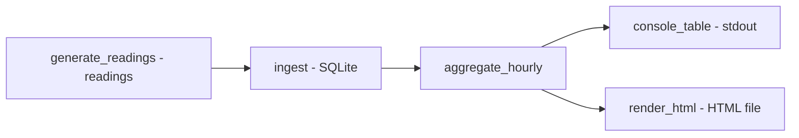

# pipeline-iot-energia

**English** · [Português (Brasil)](README.md)

[](#) [](#) [](#) [](LICENSE)

## What it is

An **IoT energy data pipeline**: it generates simulated sensor consumption readings (with a fixed seed → deterministic), **ingests them into SQLite**, **aggregates by hour** and produces a **dashboard** in the console or as HTML. It is an educational data-pipeline lab in pure Python (stdlib + SQLite), with no external dependencies.

## Status

An educational data lab, working and tested (13 tests).

## Features

- **Deterministic reading generation** (`generate_readings`): energy sensors, reading count, fixed `--seed` (20261015 default).
- **SQLite ingestion** (`ingest.py`): writes readings into a local database (default `data/pipeline.db`).
- **Hourly aggregation** (`aggregate_hourly`): consolidates consumption per hour.
- **Dashboard**: a console table (`print_console`) and HTML rendering (`render_html`).
- **CLI** `pipeline-iot-energia`: `--db`, `--leituras`, `--seed`, `--start`, `--html`.

## Architecture

A `pipeline_iot_energia` package with three stages: `ingest` (generate + write), `aggregate` (consolidate by hour) and `dashboard` (console/HTML). Orchestrated by `__main__.py`.



## Stack

- Python ≥ 3.10, stdlib only (sqlite3, argparse)
- pytest (dev)

## Repository layout

```
pipeline-iot-energia/
├── pyproject.toml · BRIEF.md
├── src/pipeline_iot_energia/
│   ├── ingest.py      # generates readings, writes to SQLite
│   ├── aggregate.py   # aggregates consumption by hour
│   ├── dashboard.py   # console + HTML
│   └── __main__.py    # CLI
├── tests/test_pipeline.py
└── LICENSE           # MIT
```

## Prerequisites and installation

Python ≥ 3.10.

```bash
pip install -e .
```

## How to run

```bash
# full pipeline: generate, ingest, aggregate and print to console
pipeline-iot-energia --leituras 200 --seed 20261015

# also generate an HTML dashboard
pipeline-iot-energia --html dashboard.html
```

## Tests and quality

Real command (verified by the agent):

```bash
python -m pytest tests/
# 13 passed
```

There is no CI configured in this repository.

## Technical decisions and trade-offs

- **SQLite instead of a heavy database/collector**: simple, local and dependency-free; right for a lab.
- **Seed-based deterministic readings**: reproducible; the cost is they are not from real sensors.
- **Hourly aggregation in pure Python**: transparent and light.

## Known limitations and roadmap

- The readings are synthetic (simulated), not from real devices.
- The dashboard is static (console/generated HTML); no interactive charts or streaming.
- No web server; HTML is generated as a file.

## Development process

An individual project by Kelvin Oliveira, built with orchestrated AI agents and reviewed by the author. The pipeline, the aggregation and the review are the author's.

## License and author

MIT — Copyright (c) 2026 Kelvin Rebelo de Oliveira.

**Author**: [Kelvin Oliveira](https://github.com/KelvinOliveiraCode) · [Portfolio](https://kelvinoliveiracode.github.io/portfolio/)
