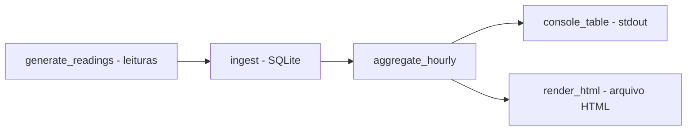

# pipeline-iot-energia

[English](README.en.md) · **Português (Brasil)**

[](#) [](#) [](#) [](LICENSE)

## O que é

**Pipeline de dados IoT de energia**: gera leituras simuladas de sensores de consumo (com semente fixa → determinísticas), **ingere em SQLite**, **agrega por hora** e gera um **dashboard** no console ou em HTML. É um laboratório educacional de pipeline de dados em Python puro (stdlib + SQLite), sem dependências externas.

## Status

Laboratório educacional de dados, funcional e testado (13 testes).

## Funcionalidades

- **Geração de leituras determinísticas** (`generate_readings`): sensores de energia, número de leituras, `--seed` fixo (20261015 default).
- **Ingestão em SQLite** (`ingest.py`): grava leituras num banco local (default `data/pipeline.db`).
- **Agregação horária** (`aggregate_hourly`): consolida consumo por hora.
- **Dashboard**: tabela no console (`print_console`) e renderização HTML (`render_html`).
- **CLI** `pipeline-iot-energia`: `--db`, `--leituras`, `--seed`, `--start`, `--html`.

## Arquitetura

Pacote `pipeline_iot_energia` com três estágios: `ingest` (gerar+gravar), `aggregate` (consolidar por hora) e `dashboard` (console/HTML). Orquestrado pelo `__main__.py`.



## Stack

- Python ≥ 3.10, stdlib apenas (sqlite3, argparse)
- pytest (dev)

## Estrutura do repositório

```
pipeline-iot-energia/
├── pyproject.toml · BRIEF.md
├── src/pipeline_iot_energia/
│   ├── ingest.py      # gera leituras e grava em SQLite
│   ├── aggregate.py   # agrega consumo por hora
│   ├── dashboard.py   # console + HTML
│   └── __main__.py    # CLI
├── tests/test_pipeline.py
└── LICENSE           # MIT
```

## Pré-requisitos e instalação

Python ≥ 3.10.

```bash
pip install -e .
```

## Como executar

```bash
# pipeline completo: gera, ingere, agrega e imprime no console
pipeline-iot-energia --leituras 200 --seed 20261015

# também gera dashboard HTML
pipeline-iot-energia --html dashboard.html
```

## Testes e qualidade

Comando real (verificado pelo agente):

```bash
python -m pytest tests/
# 13 passed
```

Não há CI configurado neste repositório.

## Decisões técnicas e trade-offs

- **SQLite em vez de um banco/coleíor pesado**: simples, local e sem dependência; adequado a um laboratório.
- **Leituras determinísticas por seed**: reproduzíveis; o custo é não serem de sensores reais.
- **Agregação por hora em Python puro**: transparente e leve.

## Limitações conhecidas e roadmap

- As leituras são sintéticas (simuladas), não de dispositivos reais.
- O dashboard é estático (console/HTML gerado); sem gráficos interativos nem streaming.
- Sem backend/web server; o HTML é gerado como arquivo.

## Processo de desenvolvimento

Projeto individual de Kelvin Oliveira, construído com agentes de IA orquestrados e revisado pelo autor. O pipeline, a agregação e a revisão são do autor.

## Licença e autor

MIT — Copyright (c) 2026 Kelvin Rebelo de Oliveira.

**Autor**: [Kelvin Oliveira](https://github.com/KelvinOliveiraCode) · [Portfólio](https://kelvinoliveiracode.github.io/portfolio/)
